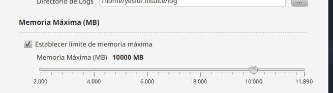

# Changelog

## v1.4.0

- Versiones de aplicaciones actualizadas:
  
  - ilivalidator 1.15.0
  - ili2gpkg 5.5.1
  - ili2mssql 5.5.1
  - ili2pg 5.5.1

- Java actualizado a 21

- Corregida ejecución de los jars

- Agregada opción para configurar la memoria máxima de ejecución

- El comando que se ejecuta se muestra correctamente

